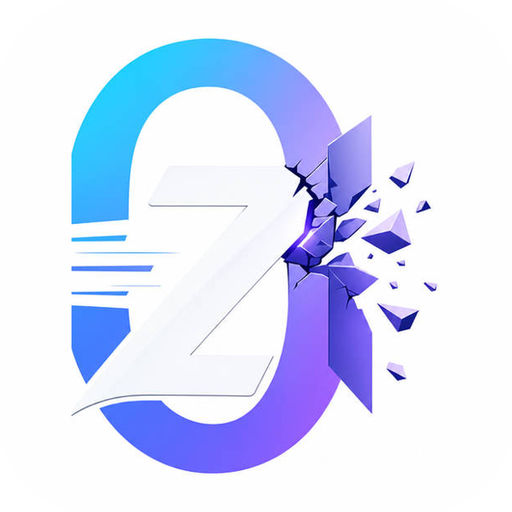

# ZeroWall Science 官网与文档

统一提供 ZeroWall Science 产品介绍、Stable 下载、公开使用指南与文档管理后台。

- 官网：<https://zerowallscience.org/>，英文入口：<https://zerowallscience.org/en/>
- 公开文档：<https://zerowallscience.org/docs/>
- 管理后台：<https://zerowallscience.org/admin/>，仅管理员登录，公众注册关闭。
- 正式目录保存即发布；草稿放在“草稿（不公开）”独立目录。
- 首批 13 篇中文指南基于上线时 Stable 6.1.0。下载按钮通过经过校验的 Stable 元数据持续更新。

## 项目结构

| 路径 | 内容 |
| --- | --- |
| website/ | Astro 官网，中英文页面、主题与动态下载信息 |
| frontend/ | React 文档阅读与后台编辑界面 |
| backend/ | Hono API、权限、SQLite、附件与备份 |
| content/docs/ | 首批指南与目录清单，仅补充缺失文档，不覆盖后台正文 |
| deploy/ | 独立 Compose、Nginx 与部署脚本 |

## 开发和发布

Node.js 20；分别在 website、frontend、backend 执行 npm ci。
官网运行 npm run dev，文档前端运行 npm run dev，后端运行 npm run dev。
生产使用 GitHub Actions，在 Runner 完成测试、构建和镜像制作，再部署到 uscavaslinux。
推送 main 或手动运行 Deploy production；每六小时自动重新解析 Stable 下载元数据。
详细维护、备份和回滚方法见 [本站部署说明](docs/zerowallscience-deployment.md)。

账号、密码、JWT 与部署私钥不进入仓库。生产后台初始密码仅由部署环境注入，重复部署不会重置账号。

## 许可证与归属

文档编辑系统基于 [Nowen Note](https://github.com/cropflre/nowen-note)，保留原 Git 历史、
[GPL-3.0 许可证](LICENSE) 及原有第三方归属说明。
[上游 README 存档](docs/upstream-README.md) 供历史参考，不代表本站配置。
ZeroWall Science 桌面产品遵循自身许可证，本仓库不包含或修改桌面项目源码。
